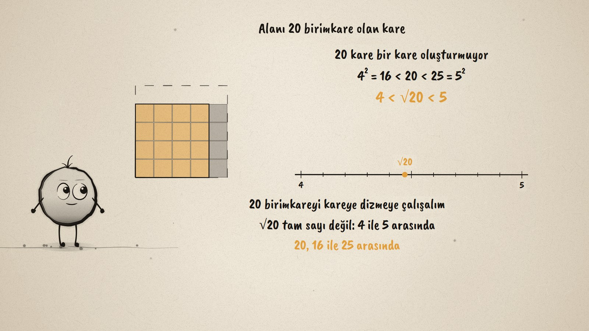
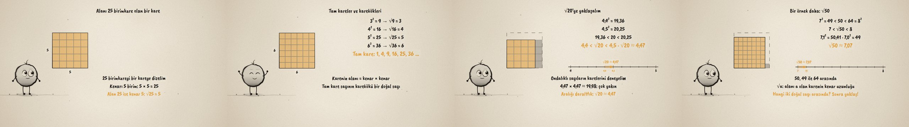

# Karenin Kenarı · Square Roots

**▶ Tarayıcıda izleyin / Watch in the browser:** https://hakanatas.github.io/karenin-kenari/ 
**⬇ MP4 + altyazılar / MP4 + subtitles:** [Releases](https://github.com/hakanatas/karenin-kenari/releases) 
**✎ Kullanılan istem / The prompt behind it:** [PROMPT.md](PROMPT.md) 
**🎞 Bütün filmler / All films:** [Nokta'nın Filmleri](https://hakanatas.github.io/nokta-filmleri/?sinif=8)

> **TR —** 8. sınıf matematik "Sayılar ve Nicelikler" temasındaki MAT.8.1.2 öğrenme çıktısı için hazırlanmış, tamamen JavaScript ile çizilen 92 saniyelik mürekkep animasyonu. 25 birimkare bir kareye diziliyor: kenar 5, alan = kenar × kenar, √25 = 5. Kenar 1'den 6'ya büyürken tam kareler (1, 4, 9, 16, 25, 36) ve karekökleri eşleşiyor: karekök alandan kenara gidiyor. 20 birimkare bir kare oluşturmuyor: 16 < 20 < 25 olduğundan √20, 4 ile 5 arasında. Ondalıklı sayıların kareleriyle aralık daraltılıyor (4,4² = 19,36; 4,5² = 20,25) ve √20 ≈ 4,47 sayı doğrusunda gösteriliyor. Aynı yol √50 için tekrarlanıyor (7 ile 8 arasında, ≈ 7,07) ve karekök kendi sözlerimizle açıklanıyor: alanı a olan karenin kenar uzunluğu. Altyazılar Türkçe, İngilizce ya da ikisi birlikte seçilebilir.

A 92-second ink animation for **8th-grade maths**. Nokta, the ink character from [The Learning Ink](https://github.com/hakanatas/the-learning-ink), is the guide again. `grid(N, n, k)` in `scenes/scene1.js` draws k unit cells inside an N × N outline, filling an n × n square first; 25 cells, the growing perfect squares, the 20 cells that do not fit and the 50 cells for √50 are all the same call.

## Learning outcome

MEB, Türkiye Yüzyılı Maarif Modeli, Ortaokul Matematik, 8th grade, "Sayılar ve Nicelikler" theme:

**MAT.8.1.2. Karşılaştığı problem durumlarında kareköklü ifadeler ile ilgili muhakeme yapabilme**
- a) Bir karenin alanı ile kenar uzunluğu arasındaki ilişkiyi belirler.
- b) Karenin alanından hareketle tam kare pozitif tam sayılar ile kareköklerini ilişkilendirir.
- c) Tam kare olmayan pozitif bir sayının karekökünün hangi iki doğal sayı arasında olduğunu ve yaklaşık değerini matematiksel temsillerle ifade eder.
- ç) Bir sayının karekökünü kendi ifadeleri ile açıklar.

## Scenes

| # | Time | Scene | What happens | Outcome |
|---|---|---|---|---|
| 1 | 0–10 s | Kare | 25 cells make a 5 × 5 square: √25 = 5. | a |
| 2 | 10–28 s | Tam kareler | Squares from 1 to 36 and their roots. | b |
| 3 | 28–46 s | Alan 20 | 16 < 20 < 25, so 4 < √20 < 5. | c |
| 4 | 46–64 s | Yaklaş | 4,4² = 19,36 and 4,5² = 20,25: √20 ≈ 4,47. | c |
| 5 | 64–80 s | √50 | Between 7 and 8, ≈ 7,07; the root in our own words. | c, ç |
| 6 | 80–92 s | Aklında kalsın | First the interval, then get closer. | a–ç |

## Running it

- **Preview:** double-click `index.html` (it works offline).
- **MP4:** run `npm install` once, then `npm run export -- --format=horizontal --captions=tr`.
- **Subtitles and narration:** `npm run srt` writes `out/captions_*.srt` and `narration_notes.txt`.
- **Editing:**
  - Caption text, timings and narration notes: `captions.js`
  - Everything on screen is drawn by `LI.world(t)` in `scenes/scene1.js` (the grids, the number line, the equations, the words); the other scenes only set the camera.
  - Nokta's poses: `src/draw/film.js`; layout for 16:9 and 9:16: `src/draw/kd.js`

It uses the same engine as The Learning Ink: `renderFrame(t)` as a pure function of time, seeded randomness, and frame-by-frame export.

## Lisans · License

**TR —** Bu film ve kodu [Creative Commons Atıf-GayriTicari 4.0 Uluslararası (CC BY-NC 4.0)](https://creativecommons.org/licenses/by-nc/4.0/deed.tr) lisansıyla paylaşılır. Ticari olmayan her amaçla (derste, okulda, eğitim materyalinde) kopyalayabilir, paylaşabilir ve değiştirebilirsiniz; ancak **kaynak göstermek zorunludur**: eser sahibinin adı ve bu deponun bağlantısı belirtilmeden kullanılamaz. Ticari kullanım (satış, ücretli ürün ya da yayın) için izin alınmalıdır.

**EN —** This film and its code are licensed under [Creative Commons Attribution-NonCommercial 4.0 International (CC BY-NC 4.0)](https://creativecommons.org/licenses/by-nc/4.0/). You may copy, share and adapt them for non-commercial purposes, but **attribution is required**: they may not be used without crediting the author and linking to this repository. Commercial use requires permission.

Atıf örneği / Required credit: *“Karenin Kenarı”, Hakan Ataş, Nokta'nın Filmleri — https://github.com/hakanatas/karenin-kenari — CC BY-NC 4.0*
